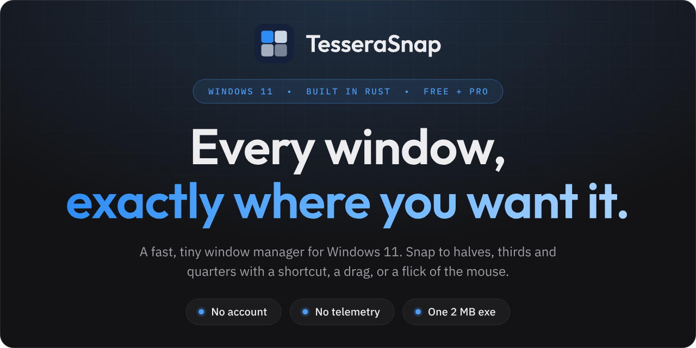

  

# TesseraSnap downloads

TesseraSnap is a keyboard-and-gesture window manager for Windows 11.

**Download the latest version from [Releases](https://github.com/pattont/tesserasnap-releases/releases/latest):** `TesseraSnap-Installer.exe` installs it; `tesserasnap-x64.exe` is the portable version.

This repository only holds the release files. TesseraSnap updates itself from here: use Check for
Updates in the tray menu, or turn on automatic checks in Settings.

Help and contact: [tesserasnap.com/support](https://tesserasnap.com/support)
